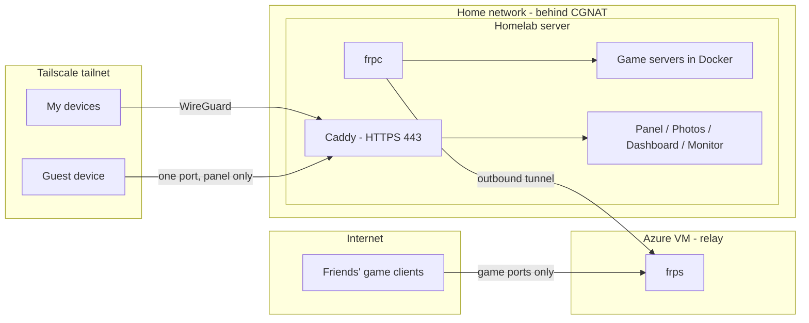

# Fujiken Homelab

A self-hosted homelab that I built and run on an old gaming laptop. It hosts game servers
for my friends, a private photo library, and an internal dashboard. It sits behind CGNAT,
so nothing on my home network is open to the internet.

I'm a cybersecurity graduate focused on **cloud security**. I use this lab to practice the
same patterns companies use: zero trust access, least privilege, a single reverse proxy
with automated TLS, policy as code, and real documentation.

> Running since June 2026. This is a sanitized public summary. It leaves out IP addresses,
> hostnames, usernames, and other details that would help an attacker. The full runbook
> lives in a private repo.

---

## At a glance

| Part | What I use |
| --- | --- |
| Server | Gaming laptop (Ryzen 5 6600H, 24 GB RAM) running Ubuntu Server 24.04 from an external NVMe |
| Public entry | A small Azure VM that works as a reverse-tunnel relay |
| Private access | Tailscale (WireGuard) mesh network with identity-based rules |
| Front door for private apps | Caddy reverse proxy with automatic wildcard TLS |
| DNS + email | My own domain on Cloudflare: DNS, email routing, anti-spoofing |
| Workloads | Minecraft + Terraria servers (Pterodactyl + Docker), Immich photo library, Homepage dashboard, custom monitoring |
| Users | Me, a small group of friends (game servers only), and one guest with limited panel access |

---

## Architecture

**The key idea:** the server only makes **outbound** connections. Game traffic comes in
through the cloud relay and down an outbound tunnel. Admin access and private apps never
touch the public internet. They are only reachable over Tailscale.

Cloudflare Tunnel, ngrok, and Tailscale Funnel sell this same relay pattern as products.
This is my self-hosted version of it.

---

## Security design

### 1. Nothing inbound at home
The home network has no port forwarding and no public services. CGNAT hides it, and the
server only dials out. Changing ISPs or routers doesn't affect remote access.

### 2. Small public surface
Only the relay is public, and it only exposes the game ports and the tunnel's control port.
Admin SSH on the relay is **closed to the internet** and only works over Tailscale.
Firewalls run at two layers: the cloud network security group and the host firewall (UFW).

### 3. Zero trust for everything private
To reach a private app, a request has to pass **four separate checks**:
1. The device must be logged into my tailnet (identity)
2. A tailnet policy must allow that user to that host and port
3. The reverse proxy must allow that device to that app's hostname
4. The app's own login

Private hostnames do resolve in public DNS, but only to private tailnet addresses.
**Knowing a name gives you nothing.** Security comes from identity and policy, not from
keeping names secret.

### 4. One front door
All private apps sit behind a single Caddy reverse proxy:
- HTTPS for everything, with certificates that renew by themselves
- A **wildcard certificate** obtained through a DNS challenge. Public Certificate
  Transparency logs only show the wildcard, so my individual app names don't leak.
  Nothing has to be public to get the certificate.
- The host firewall only lets tailnet devices reach the proxy
- Any unknown hostname gets its connection dropped

### 5. Least privilege for a guest user
A friend helps run one of the game servers. His access is limited at every layer:
- **Network:** a tailnet grant to one host and one port
- **Policy tests:** the access policy includes automated tests. They check that he
  **can** reach the one allowed port and **can't** reach SSH or any other service. If a
  change would widen his access, the policy refuses to save. It's policy as code with tests.
- **Proxy:** IP-based rules only let his device reach the game panel hostnames
- **App:** the panel role only shows his own server

### 6. Email security
- **DMARC set to reject.** The domain never sends mail, so any mail claiming to be from it is fake.
- **Receive-only aliases.** Every service gets its own address. If one starts getting spam,
  I know who leaked it, and I can block just that alias. The real inbox stays hidden.

### 7. Hardening basics
- SSH: keys only, root login disabled, fail2ban on both machines
- Database bound to localhost only
- The DNS API token only has DNS rights for one domain, and it lives in a locked env file, not in the config
- 2FA on the accounts that control DNS and network access
- **Removed services I didn't use**, including a Docker admin UI with root-level access.
  Less software = less attack surface.

### 8. Self-assessment
I ran a read-only recon engagement against my own setup from Kali Linux (nmap, nikto,
curl). It found a database listening on all network interfaces. I fixed it in the same
session and verified the fix with a second scan. Later, I moved relay admin access to
Tailscale only and confirmed public SSH was closed. A follow-up scan after the October
2026 changes is next, so I can compare before and after.

---

## Problems I solved

**Container IP roulette.** The tunnel pointed at a Docker container's internal IP. Once I
ran more than one server, those IPs could swap after a restart, which would send players
to the wrong world. I pinned each server to its own fixed loopback address and pointed the
tunnel there instead.

**Many servers, one tunnel.** One tunnel connection can carry many forwarded ports. Each
server got its own port and subdomain. For the server on a non-default port, I added a
DNS **SRV record**, so players just type the name and the game finds the port by itself.

**Mixed content.** After I moved the game panel to HTTPS, the in-browser server console
stopped working. The browser talks directly to the game daemon, and it was blocking that
plain-HTTP connection from an HTTPS page. I put the daemon behind the same reverse proxy
on its own hostname. It still runs plain HTTP internally, and the proxy handles TLS.

**Port collisions.** The reverse proxy and an existing web server both wanted port 80.
Later, the game daemon tried to take 443 from the proxy. Both times the fix was to
separate the port the **browser** uses from the port the service **listens** on inside
the box.

**Firewall vs. containers.** A dashboard widget couldn't read my monitoring API. The host
firewall was blocking traffic from Docker's internal network. I allowed only Docker's
private range to that one port, nothing else.

**Policy tests doing their job.** When I tightened the guest's access, the save failed,
because an old test still expected the old ports. I had to update the rule and the test
together. That's exactly what the tests are for: no silent changes to access.

---

## Operations

- **Monitoring:** a web dashboard with history graphs and a JSON API, a live terminal
  dashboard, and health-check scripts for both machines
- **Alerts:** a Telegram bot sends a status report every 2 hours and electricity cost
  reports on demand. It also runs a **fixed whitelist** of admin commands (no shell access)
- **Internal portal:** a Homepage dashboard with live server and photo stats, up/down
  status for each app, and bookmarks. It's my browser's start page
- **Backups:** weekly automated world backups with rotation. Old backups are only deleted
  after a new one succeeds
- **Planned maintenance:** a scheduled weekly shutdown with an alert first, a CPU frequency
  cap for thermals, and a UPS for brownouts
- **Documentation:** a private runbook with the full inventory, port map, troubleshooting
  log, disaster recovery plan, and cost tracking. It gets updated with every change

---

## Timeline

| When | What |
| --- | --- |
| Jun 2026 | Server and cloud relay live. Pterodactyl game panel. First monitoring scripts and Telegram alerts |
| Jun 25, 2026 | Self pentest. Database exposure found and fixed the same day |
| Jul 2026 | Web monitoring dashboard + JSON API. Self-hosted photo library |
| Sep 2026 | Full operations review: crontab, backups, chat-ops bot, bandwidth, and costs |
| Oct 8, 2026 | Relay admin moved to Tailscale only. Public SSH closed. Backup rotation |
| Oct 9–10, 2026 | Own domain. Per-server subdomains. Reverse proxy with wildcard TLS. Internal dashboard. Guest least privilege with policy tests. Email anti-spoofing. Removed an unused Docker admin UI |

---

## Roadmap

- Make the tunnel client start reliably on every boot
- Add an offsite backup copy and scheduled restore tests
- More granular device policies in the tailnet
- Re-run the pentest for a before/after comparison
- Security headers on all private apps, aiming for an A+ grade
- Weekly hardware health reports (battery health, SSD wear)
- A SIEM (Wazuh) on a separate cloud instance
- A portfolio site on my domain

---

## Skills this shows

- **Network design:** CGNAT, reverse tunnels, relay architecture
- **Zero trust access:** identity-based access, least privilege, defense in depth
- **Policy as code:** access rules with automated allow/deny tests
- **PKI / TLS automation:** ACME, DNS-01 challenges, wildcard certificates
- **DNS:** A, CNAME, SRV, MX, and TXT records
- **Email security:** SPF, DKIM, DMARC
- **Linux and containers:** Ubuntu Server, systemd, Docker, Docker Compose
- **Firewalls:** cloud network security groups and host firewall rules
- **Monitoring and alerting:** custom dashboards, a JSON API, chat-ops alerts
- **Security assessment:** recon with nmap, nikto, and curl, then fixing findings
- **Documentation and cost tracking:** runbooks, disaster recovery plans, monthly costs

---

*Last updated: October 2026*
